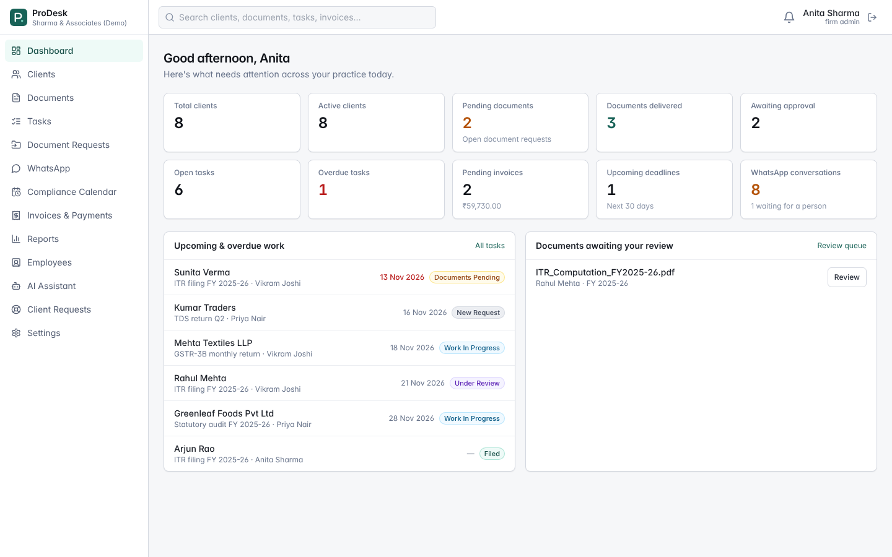
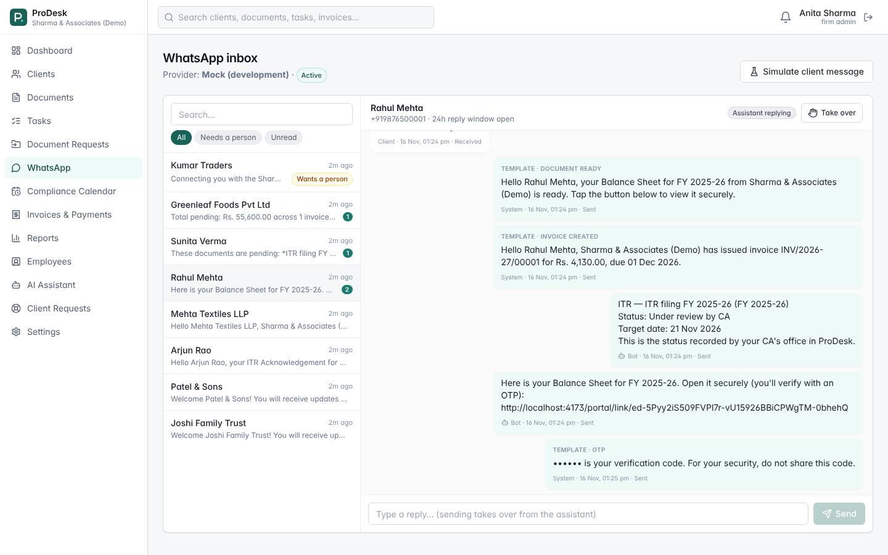
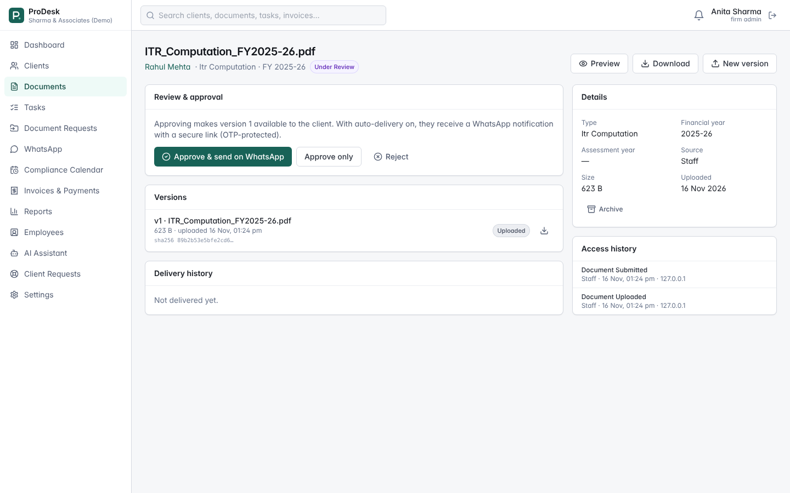
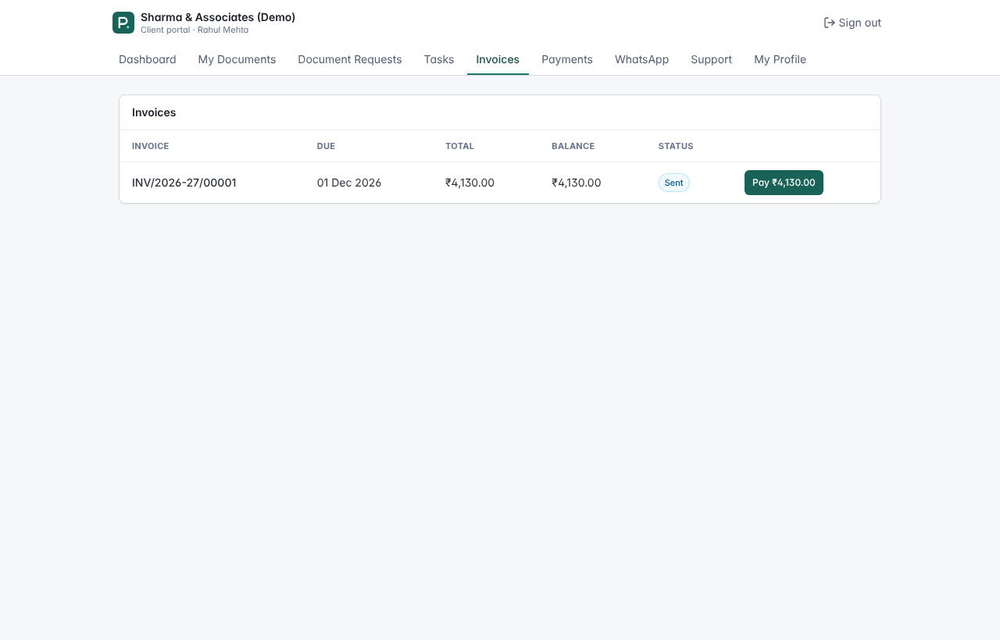
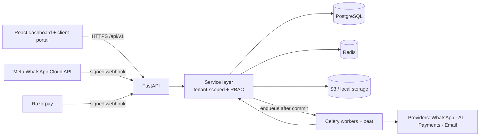

# ProDesk

[](https://render.com/deploy?repo=https://github.com/Dinesh-0406/prodesk)

* **Live Frontend (Vercel):** [https://prodesk-ca.vercel.app](https://prodesk-ca.vercel.app)
* **Live Client Portal (Vercel):** [https://prodesk-ca.vercel.app/portal/login](https://prodesk-ca.vercel.app/portal/login)
* **GitHub Repository:** [https://github.com/Dinesh-0406/prodesk](https://github.com/Dinesh-0406/prodesk)

**Practice management and client automation for Indian CA firms, with WhatsApp as the main client channel.**

ProDesk handles the repetitive client work a CA firm does every day: collecting documents, delivering finished work, follow-ups, status questions, invoices and payment reminders. WhatsApp (the official Meta Cloud API) is how clients interact with it. The ProDesk database is always the source of truth, and the AI layer only classifies requests. It never decides who can see what, and it never invents facts.

```
Client + Work + Documents + Communication + Follow-ups + Payments + Automation
```

The core workflow:

```
CA uploads → reviews → approves → ProDesk sends a WhatsApp template → client opens a secure link
→ verifies with an OTP → downloads a short-lived signed URL → the access is audit-logged
```

---

## Contents
- [Architecture](#architecture) · [Tech stack](#tech-stack) · [Folder structure](#folder-structure)
- [Requirements](#requirements) · [Local setup](#local-setup) · [Environment variables](#environment-variables)
- [Database migrations](#database-migrations) · [Seed data](#seed-data)
- [Run backend / frontend / workers](#run-services-without-docker) · [Run tests](#run-tests)
- [WhatsApp setup](#whatsapp-setup) · [Meta webhook setup](#meta-webhook-setup) · [Razorpay setup](#razorpay-setup) · [S3 setup](#s3-setup) · [AI setup](#ai-setup)
- [Production deployment](#production-deployment) · [Troubleshooting](#troubleshooting)

| Dashboard | WhatsApp inbox |
|---|---|
|  |  |
| **Document review** | **Client portal** |
|  |  |

Detailed docs: [architecture](docs/architecture.md) · [API](docs/api.md) · [WhatsApp](docs/whatsapp.md) · [security](docs/security.md) · [deployment](docs/deployment.md)

---

## Architecture

The app is a **modular monolith**: one FastAPI application with clear internal modules, plus Celery workers that share the same code. There are no microservices.



All business logic lives in `backend/app/services`. Each external system sits behind a provider interface with a mock implementation, so the whole app runs locally with **no credentials**. Moving to production is a configuration change only.

## Tech stack

| Layer | Choice |
|---|---|
| API | Python 3.12+, FastAPI, Pydantic v2, OpenAPI/Swagger |
| Data | PostgreSQL 16, SQLAlchemy 2.x, Alembic (UUID primary keys, trigram search indexes) |
| Async work | Celery on Redis (retries, exponential backoff, job status table, beat schedules) |
| Auth | JWT access tokens (15 min) and rotating refresh tokens (httpOnly cookie, reuse detection), Argon2 hashing, client OTP |
| Frontend | React 18, TypeScript, Vite, Tailwind CSS, TanStack Query, React Router |
| Integrations | Meta WhatsApp Cloud API, Razorpay, OpenAI, AWS S3, SMTP (each with a mock) |
| Quality | Ruff, mypy, pytest (98 tests); ESLint, tsc, Vitest (14 tests) |

## Folder structure

```
prodesk/
├── backend/
│   ├── app/
│   │   ├── api/            # FastAPI routers (/api/v1/...), auth dependencies
│   │   ├── core/           # config, security, permissions, logging, rate limiting, errors
│   │   ├── db/             # declarative base, session
│   │   ├── models/         # SQLAlchemy models (33 tables)
│   │   ├── schemas/        # Pydantic request/response models
│   │   ├── repositories/   # tenant-aware repository base
│   │   ├── services/       # business logic (documents, delivery, messaging, assistant/…)
│   │   ├── integrations/   # whatsapp/ ai/ payments/ storage/ email/ (provider + mock)
│   │   ├── workers/        # Celery app, tasks, after-commit dispatch
│   │   ├── cli.py          # python -m app.cli seed | create-superadmin | …
│   │   └── main.py
│   ├── migrations/         # Alembic
│   ├── scripts/smoke_test.py
│   ├── tests/              # pytest (real Postgres + Redis)
│   ├── Dockerfile · docker-entrypoint.sh · alembic.ini · pyproject.toml · requirements*.txt
├── frontend/
│   ├── src/{components,features,pages,layouts,services,hooks,types,utils,test}
│   ├── Dockerfile · nginx.conf · package.json
├── docs/                   # architecture, api, whatsapp, security, deployment
├── docker-compose.yml      # local stack (mock providers)
├── docker-compose.prod.yml # production-oriented (managed DB/Redis/S3)
├── .env.example · .gitignore · Makefile · README.md
```

## Requirements

- **With Docker:** Docker 24+ with Compose v2.
- **Without Docker:** Python 3.12+, Node 20+, PostgreSQL 14+ (with the `pg_trgm` extension available), Redis 6+.

## Local setup

```bash
cp .env.example .env          # mock providers by default; nothing else needed
docker compose up --build
```

| URL | What |
|---|---|
| http://localhost:8080 | Dashboard and client portal (nginx, proxies `/api`) |
| http://localhost:8000/docs | Swagger / OpenAPI |
| http://localhost:8000/health/ready | Readiness (DB, Redis, storage, provider modes) |

The backend container runs migrations and seeds demo data automatically (`RUN_MIGRATIONS=1`, `SEED_DEMO_DATA=1` in compose).

**Demo logins** (fake data; the password for all of them is `Demo@12345`):

| Role | Email |
|---|---|
| Firm admin | `admin@demo.example.com` |
| Partner | `partner@demo.example.com` |
| Manager | `manager@demo.example.com` |
| Employee (sees only assigned clients) | `employee@demo.example.com` |

For the **client portal**, open `/portal/login`, enter firm code `sharma-associates` and phone `9876500001`. In development with the mock WhatsApp provider, the OTP is shown on screen.

To try WhatsApp locally, go to **WhatsApp → Simulate client message** and send things like "Mera ITR status kya hai?", "Mujhe pichle saal ki balance sheet bhejo" or "CA se baat karni hai", or attach a file. The simulated message goes through the same signed webhook, queue and worker path as a real Meta delivery.

## Environment variables

Every variable is listed with comments in [`.env.example`](.env.example). The key ones:

| Variable | Local default | Production |
|---|---|---|
| `APP_ENV` | `development` | `production` (enables startup safety checks) |
| `SECRET_KEY` / `ENCRYPTION_KEY` | dev placeholders | **required**; the app refuses to start without them |
| `DATABASE_URL`, `REDIS_URL` | local | managed PostgreSQL / Redis |
| `WHATSAPP_PROVIDER` | `mock` | `meta`, plus `WHATSAPP_APP_SECRET`, `WHATSAPP_VERIFY_TOKEN`, token / phone number ID |
| `AI_PROVIDER` | `mock` | `openai` + `OPENAI_API_KEY` |
| `PAYMENT_PROVIDER` | `mock` | `razorpay` + `RAZORPAY_KEY_ID` / `RAZORPAY_KEY_SECRET` / `RAZORPAY_WEBHOOK_SECRET` |
| `STORAGE_PROVIDER` | `local` | `s3` + `S3_BUCKET`, `S3_REGION` (IAM role credentials) |
| `EMAIL_PROVIDER` | `console` | `smtp` + `SMTP_*` |
| `ENABLE_DEV_TOOLS` | `true` | ignored in production (the simulator and mock checkout are always off) |

`.env` is git-ignored. Never commit real values.

## Database migrations

The schema is managed **only** by Alembic. `create_all()` is never used outside tests.

```bash
cd backend
alembic upgrade head                                  # apply
alembic revision --autogenerate -m "describe change"  # after changing models
alembic check                                         # confirm models and migrations agree
```

## Seed data

```bash
cd backend && python -m app.cli seed     # idempotent, fake data, refuses to run in production
python -m app.cli create-superadmin you@example.com 'Str0ng-Passw0rd!'
```

The seed creates a demo firm, staff in every role, 8 clients, documents (approved, delivered and under review), tasks, document requests, invoices, and WhatsApp conversations that ran through the real assistant pipeline.

## Run services without Docker

```bash
make install                      # pip + npm
export $(grep -v '^#' .env | xargs)   # or rely on backend/.env
make migrate seed
make api      # FastAPI on :8000 (reload)
make worker   # Celery worker (queues: default, whatsapp, webhooks, documents)
make beat     # Celery beat (reminders, overdue marking, reconciliation, retention)
make web      # Vite on :5173, proxies /api → :8000
```

## Run tests

```bash
make check                 # lint + typecheck + tests + frontend build
cd backend && pytest       # needs Postgres + Redis; uses database prodesk_test and Redis db 15
cd frontend && npm test    # Vitest + Testing Library
```

Backend tests run against **real PostgreSQL and Redis**, with the schema built by the Alembic migration. Set `TEST_DATABASE_URL` / `TEST_REDIS_URL` to point elsewhere. With a stack already running, `python backend/scripts/smoke_test.py --api http://localhost:8000 --app-secret $WHATSAPP_APP_SECRET` checks the whole flow end to end.

## WhatsApp setup

ProDesk uses **only** the official Meta WhatsApp Business Platform (Cloud API). It never uses WhatsApp Web automation, unofficial libraries or QR scraping. See **[docs/whatsapp.md](docs/whatsapp.md)** for the Meta setup: developer app, business portfolio, WhatsApp Business Account, phone number ID, permanent token, templates and production checklist.

In short: set `WHATSAPP_PROVIDER=meta`, then in **Settings → WhatsApp** enter the phone number ID, WABA ID and access token (stored encrypted, never shown again). Map each ProDesk template to your Meta-approved template name and mark it **Approved**, or use *Sync status from Meta*.

## Meta webhook setup

- **Callback URL:** `https://<your-api-domain>/api/v1/webhooks/whatsapp`
- **Verify token:** the value of `WHATSAPP_VERIFY_TOKEN`
- **Subscribe to:** `messages`
- **Signature:** requests are validated with `WHATSAPP_APP_SECRET` (`X-Hub-Signature-256`). Unsigned or forged requests get a 401.

## Razorpay setup

1. Create API keys in the Razorpay Dashboard (use test mode first) and set `RAZORPAY_KEY_ID` / `RAZORPAY_KEY_SECRET`, with `PAYMENT_PROVIDER=razorpay`.
2. Add a webhook: `https://<api>/api/v1/webhooks/razorpay`, events `payment.captured`, `payment.failed`, `order.paid`. Put the webhook secret in `RAZORPAY_WEBHOOK_SECRET`.
3. Payments are recorded only after the checkout signature verifies **and** the Razorpay API confirms the payment was captured for the right order and amount (or a signed webhook says so). A reconciliation job catches cases where both the browser callback and the webhook were lost.

## S3 setup

Create a private bucket in `ap-south-1` with **Block Public Access on**, default encryption (SSE-S3 or SSE-KMS via `S3_KMS_KEY_ID`) and versioning. Give the API and worker an IAM role with `s3:PutObject`, `s3:GetObject`, `s3:DeleteObject` and `s3:ListBucket` on that bucket only. Set `STORAGE_PROVIDER=s3` and `S3_BUCKET`. Downloads use presigned GET URLs that expire after 5 minutes by default. Policy JSON is in [docs/deployment.md](docs/deployment.md).

## AI setup

Set `AI_PROVIDER=openai`, `OPENAI_API_KEY` and optionally `OPENAI_MODEL`. The model is used only for structured intent classification, FAQ matching and document-type suggestions. It returns JSON validated against a schema, and on any error, timeout or invalid output ProDesk falls back to the built-in rule-based classifier. Replies to clients are rendered from database facts, never from model output.

## Production deployment

See **[docs/deployment.md](docs/deployment.md)** for the recommended AWS layout: ALB with HTTPS → frontend (nginx) and API (ECS Fargate), plus RDS PostgreSQL, ElastiCache Redis, S3, worker and beat. Kubernetes is not required. `docker-compose.prod.yml` is a single-host starting point.

## Troubleshooting

| Symptom | Fix |
|---|---|
| `Unsafe production configuration: …` at startup | Set the variables listed (`SECRET_KEY`, `ENCRYPTION_KEY`, provider secrets). |
| Messages stuck at `QUEUED` | The worker isn't running or can't reach Redis. Check `make worker` / `docker compose logs worker`. |
| Delivery `FAILED: TEMPLATE_NOT_APPROVED` | Mark the template Approved in Settings → WhatsApp once Meta approves it, or sync from Meta. |
| `OUTSIDE_SERVICE_WINDOW` when replying | It has been more than 24 hours since the client last messaged. Use an approved template. |
| Webhook returns 401 | `WHATSAPP_APP_SECRET` doesn't match the Meta app secret. |
| Webhook verification fails | `WHATSAPP_VERIFY_TOKEN` differs from the token entered in Meta. |
| `extension "pg_trgm" is not available` | Install PostgreSQL contrib (included in the official images and RDS). |
| Client never receives OTP | The client opted out (STOP) or the OTP template isn't approved. OTP falls back to email if the client has one. |
| 429 responses | Rate limits (login, OTP, uploads, AI, webhooks). Wait for the window to pass. |

## Status: what's implemented and what needs setup

| | |
|---|---|
| **Implemented and tested** | Multi-tenant data model and isolation, RBAC, staff auth (refresh rotation, reset, activation, lockout), client OTP auth, CRM + CSV import, document vault (validation, versioning, approval, signed URLs, access log), automatic WhatsApp delivery, webhook idempotency, AI client assistant + tools, human handover, document requests, reminders, tasks, invoices, payments (verification, webhook, reconciliation), reports + CSV, professional AI assistant, compliance calendar (no invented dates), audit logs, privacy export/erasure/retention, health checks, structured logs. |
| **Configured, needs external credentials** | Meta WhatsApp Cloud API, Razorpay, OpenAI, S3, SMTP. Code paths are implemented, but in this build they were exercised only through the mocks and unit tests, not against the live services. |
| **Needs production infrastructure** | HTTPS/ALB, managed Postgres/Redis, S3 bucket + IAM, secrets manager, backups, monitoring/alerting. |

ProDesk provides technical controls that support privacy obligations (consent ledger, access control, audit trail, export, erasure, retention). It does **not** claim any legal certification or compliance status. Firms should get their own legal review (for example, under India's DPDP Act 2023).
