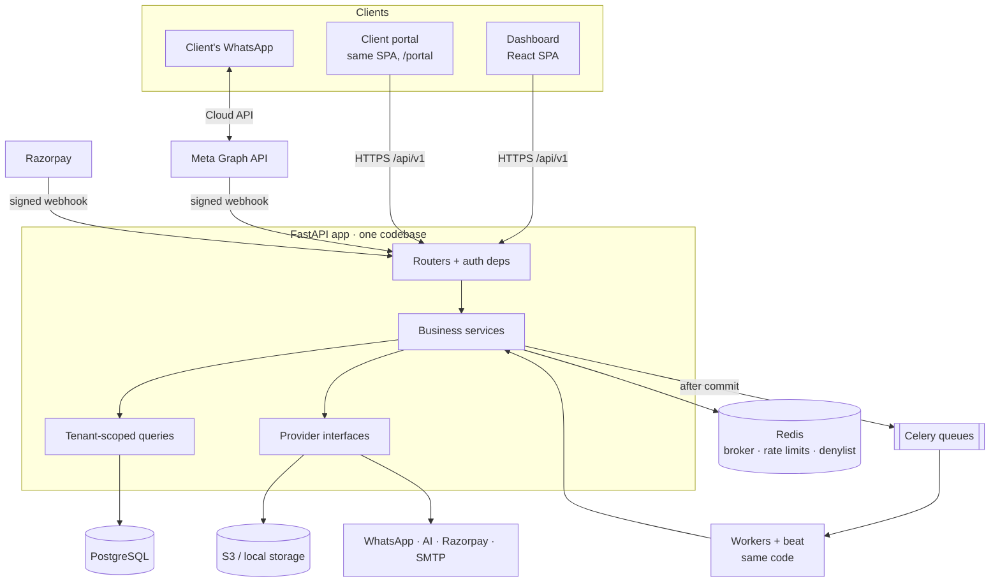
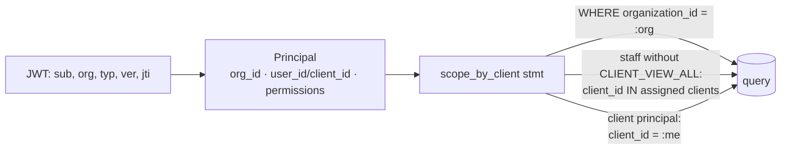
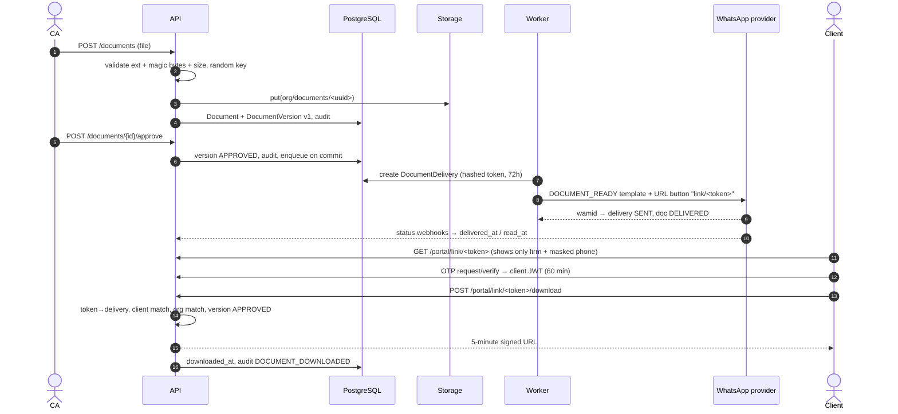
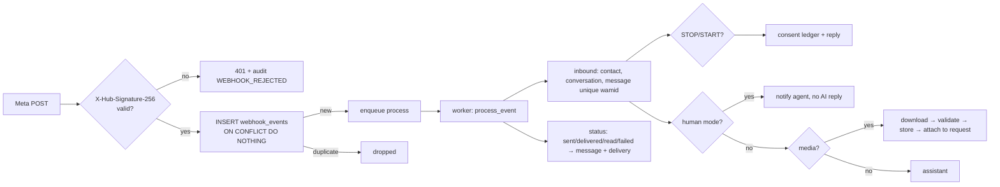
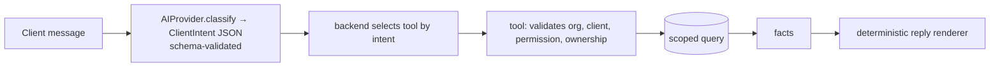

# ProDesk architecture

## Shape: a modular monolith

| Module | Responsibility |
|---|---|
| `core/` | Config, JWT/Argon2/HMAC/Fernet, permission catalogue, Principal, rate limiting, JSON logging with request/correlation IDs and secret redaction, error envelope |
| `models/` | 33 tables, UUID keys; every business table carries `organization_id` |
| `services/` | All business rules. Routers stay thin; workers call the same services |
| `services/scope.py` | The single definition of who can see which clients |
| `integrations/` | `WhatsAppProvider` (Meta, Mock), `AIProvider` (OpenAI, Mock), `PaymentProvider` (Razorpay, Mock), `StorageProvider` (S3, Local), Email (SMTP, Console) |
| `workers/` | Celery app, tasks with retries/backoff and `background_jobs` status, `enqueue_on_commit` |

### Why synchronous SQLAlchemy

Route handlers that touch the database are plain `def` endpoints, which FastAPI runs in a threadpool. Webhook intake and health checks use `async` where it helps. This keeps a single, simple transaction model shared by API and worker code. The slow parts (Meta calls, AI, media download, OCR) never run in a request; they run in workers.

### Jobs only after commit

`enqueue_on_commit(db, task, …)` registers a callback on the SQLAlchemy session that fires on `after_commit` and is dropped on rollback. A failed request can therefore never send a WhatsApp message, and a worker never sees uncommitted rows.

## Multi-tenancy

- Every business entity has `organization_id`, and every query filters on the principal's organization through `scope_by_client`, `visible_client_ids_subquery` or `TenantRepository`.
- Cross-tenant and out-of-scope lookups return **404**, never 403, so the existence of another tenant's records is not leaked.
- Background jobs run as `system_principal(org_id)`: full scope inside **one** organization only.
- Webhooks resolve the tenant from `phone_number_id → WhatsAppAccount.organization_id` (unique), never from payload claims.
- A `SUPER_ADMIN` manages the organization directory but has **no** tenant-data permissions.

## RBAC

Roles are database rows seeded from `core/permissions.py`. Code checks permissions (`principal.require(Perm.DOCUMENT_APPROVE)`), never role names.

| Role | Highlights |
|---|---|
| FIRM_ADMIN | Everything in the firm, including settings, users, WhatsApp config and audit log |
| PARTNER | Everything except firm settings |
| MANAGER | Operations; no user/settings/WhatsApp management, no deletes |
| EMPLOYEE | Only **assigned** clients (no `CLIENT_VIEW_ALL`); upload but not approve; no invoices or settings |
| CLIENT | `PORTAL_ACCESS` only; bound to their own `client_id` |

Changing a user's role or deactivating them increments `token_version`, which immediately invalidates their existing access tokens.

## Core workflow: document delivery

Replacing a document creates v2, marks earlier versions `SUPERSEDED` (kept and downloadable by staff for audit) and clears `approved_version_id`. Stale approvals are therefore never auto-delivered.

## WhatsApp pipeline

The outbound policy is enforced in `messaging.queue_message`:

1. Opted-out clients receive nothing.
2. Templates must be **APPROVED** in ProDesk's template table. Approval is never assumed.
3. Business-initiated templates require recorded opt-in (OTP is the user-requested exception).
4. Free-form messages are only allowed inside the 24-hour customer service window.
5. Policy failures are stored as FAILED messages (visible, audited) instead of raising, so automations degrade safely.

Provider errors are categorised: rate-limit and transient errors are retried with exponential backoff (up to 6 attempts). Template rejection marks the template REJECTED and notifies admins. An expired token marks the account as ERROR and notifies admins.

## AI authorization architecture

- The model sees only the message text. It has no database access and produces no SQL.
- Tools (`services/assistant/tools.py`) take a `ToolContext(principal)` and always filter by `organization_id` **and** `client_id`. `create_document_request` is staff-only.
- Replies are rendered from tool results, so a statement like "ITR filed" appears only if the task status in the database is `FILED` (with `filed_at` / `filing_reference`).
- Advice-type questions ("how much tax should I pay?") are routed to the CA as a support request.
- The **professional assistant** maps questions to six pre-built, parameterised, scoped queries. An employee asking "which clients have pending documents?" sees only their assigned clients.

## Background jobs

| Task | Trigger |
|---|---|
| `whatsapp.send_message` | after commit of any queued message (retry/backoff on 429/5xx) |
| `webhooks.process_whatsapp` | each new webhook event; `webhooks.retry_stuck` every 10 min |
| `documents.deliver` | approval (if auto-delivery on) |
| `documents.process` | each upload: checksum, PDF text, AI type/FY suggestion (not auto-applied) |
| `documents.purge_storage` | deletion / erasure: secure delete of all versions |
| `reminders.run` | every 30 min: document, payment, task, compliance and appointment reminders |
| `maintenance.mark_overdue` | hourly |
| `payments.reconcile` | every 15 min: catch lost callbacks |
| `maintenance.retention_purge` | daily: per-org retention |

Every task records status in `background_jobs` (`GET /api/v1/jobs/{task_id}`).

## Data model (main tables)

`organizations` · `users` · `roles` · `permissions` · `role_permissions` · `refresh_tokens` · `action_tokens` · `clients` · `client_otps` · `consent_records` · `documents` · `document_versions` · `document_deliveries` · `tasks` · `document_requests` · `document_request_items` · `invoices` · `invoice_items` · `payment_attempts` · `payments` · `receipts` · `whatsapp_accounts` · `whatsapp_contacts` · `conversations` · `messages` · `message_templates` · `webhook_events` · `audit_logs` · `notifications` · `reminder_logs` · `compliance_events` · `support_requests` · `background_jobs`

Important uniqueness constraints: `(organization_id, phone)` on clients, `provider_message_id` on messages, `(provider, event_key)` on webhook events, `provider_payment_id` on payments, `(organization_id, invoice_number)`, and `(organization_id, dedupe_key)` on reminder logs.
