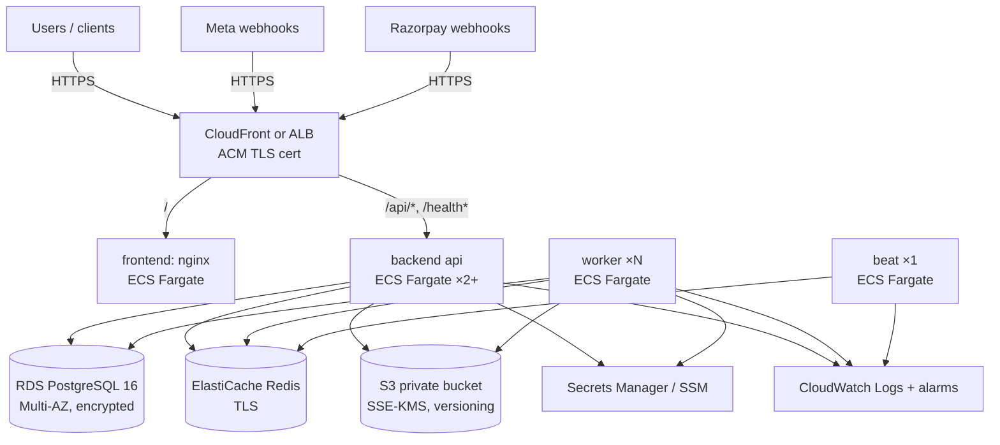

# Deploying ProDesk

Kubernetes is not required. The images are stateless and run anywhere containers run. The recommended AWS layout:



## Images

| Image | Build | Roles |
|---|---|---|
| backend | `backend/Dockerfile` (target `base`) | entrypoint argument: `api`, `worker`, `beat`, `migrate`, `seed` |
| frontend | `frontend/Dockerfile` | nginx serving the SPA; proxies `/api` to `BACKEND_URL` (or route `/api` at the ALB) |

The backend runs as a non-root user, has a health check, and works with a read-only root filesystem (with `/tmp` writable).

## Step by step (AWS)

1. **Network:** a VPC with private subnets for ECS, RDS and ElastiCache, and public subnets for the ALB.
2. **RDS PostgreSQL 16:** Multi-AZ, storage encryption, automated backups (7–35 days), deletion protection. `pg_trgm` is available on RDS; the migration creates it.
3. **ElastiCache Redis 7:** in-transit encryption (`rediss://…` URL), auth token.
4. **S3:** private bucket, Block Public Access on, SSE-KMS, versioning, and a lifecycle rule to expire noncurrent versions after N days. Add a CORS rule only if browsers fetch presigned URLs cross-origin (GET from your frontend origin).
5. **IAM task role (api + worker)**, least privilege:
   ```json
   {"Version": "2012-10-17", "Statement": [
     {"Effect": "Allow", "Action": ["s3:PutObject", "s3:GetObject", "s3:DeleteObject"], "Resource": "arn:aws:s3:::YOUR-BUCKET/*"},
     {"Effect": "Allow", "Action": ["s3:ListBucket"], "Resource": "arn:aws:s3:::YOUR-BUCKET"},
     {"Effect": "Allow", "Action": ["kms:Encrypt", "kms:Decrypt", "kms:GenerateDataKey"], "Resource": "arn:aws:kms:ap-south-1:ACCOUNT:key/KEY-ID"}
   ]}
   ```
6. **Secrets:** store `SECRET_KEY`, `ENCRYPTION_KEY`, `DATABASE_URL`, `REDIS_URL`, `WHATSAPP_*`, `RAZORPAY_*`, `OPENAI_API_KEY` and `SMTP_PASSWORD` in Secrets Manager and inject them as ECS secrets.
7. **ECS services:**
   - `migrate`: a one-off task (`migrate`) run before each deploy (CI step or ECS run-task).
   - `api`: 2 or more tasks behind the ALB; health check path `/health`; readiness `/health/ready`.
   - `worker`: scale on queue depth / CPU. Queues are `default, whatsapp, webhooks, documents`; you can split the WhatsApp and webhooks queues into their own service.
   - `beat`: **exactly one** task.
   - `frontend`: nginx (or upload `dist/` to S3 + CloudFront and route `/api/*` to the ALB).
8. **ALB:** HTTPS listener with an ACM certificate, HTTP→HTTPS redirect, and an idle timeout of at least 60 s. Rules: `/api/*` and `/health*` → api, everything else → frontend.
9. **DNS:** for example `app.yourfirm.in` (frontend) and the same host or `api.yourfirm.in` for the API. Set `FRONTEND_URL`, `PUBLIC_API_URL` and `CORS_ORIGINS` to match.
10. **Production environment:**
    ```
    APP_ENV=production
    LOG_JSON=true
    REFRESH_COOKIE_SECURE=true
    STORAGE_PROVIDER=s3     WHATSAPP_PROVIDER=meta     PAYMENT_PROVIDER=razorpay     AI_PROVIDER=openai
    EMAIL_PROVIDER=smtp     ENABLE_DEV_TOOLS=false
    ```
    The API refuses to start if required secrets are missing or still set to defaults.
11. **Webhooks:** configure the Meta and Razorpay webhook URLs (see [whatsapp.md](whatsapp.md) and the README).
12. **Create the platform admin:** `docker run … backend python -m app.cli create-superadmin you@firm.in '…'`. Firms then self-register at `/register`, or you can create them for them.

## Operations

- **Logs:** JSON on stdout (CloudWatch). Fields include `request_id`, `correlation_id` (propagated into Celery jobs), `method`, `path`, `status`, `ms`. Secrets are redacted.
- **Alarms (suggested):** ALB 5xx rate, `/health/ready` failures, Redis memory, RDS CPU/storage/connections, Celery queue depth, failed `background_jobs`, `webhook_events` stuck in FAILED, rising message `FAILED` rate.
- **Backups:** RDS automated backups plus snapshots before migrations; S3 versioning. Test restores regularly.
- **Scaling:** the API is stateless; add tasks freely. Rate limits and the token denylist live in Redis, so all instances share them.
- **Zero-downtime migrations:** use expand → migrate → contract. Run `alembic upgrade head` before shifting traffic.
- **Key rotation:** rotating `SECRET_KEY` invalidates all sessions and links. `ENCRYPTION_KEY` rotation needs re-encrypting `whatsapp_accounts` secrets; plan it as a migration using `MultiFernet`.

## Single-host alternative

On a single VM (for example EC2 or Lightsail) with managed Postgres and Redis:

```bash
cp .env.example .env.production   # fill in production values
docker compose -f docker-compose.prod.yml --env-file .env.production up -d --build
```

Put Caddy, nginx or an ALB with TLS in front of port 80.
